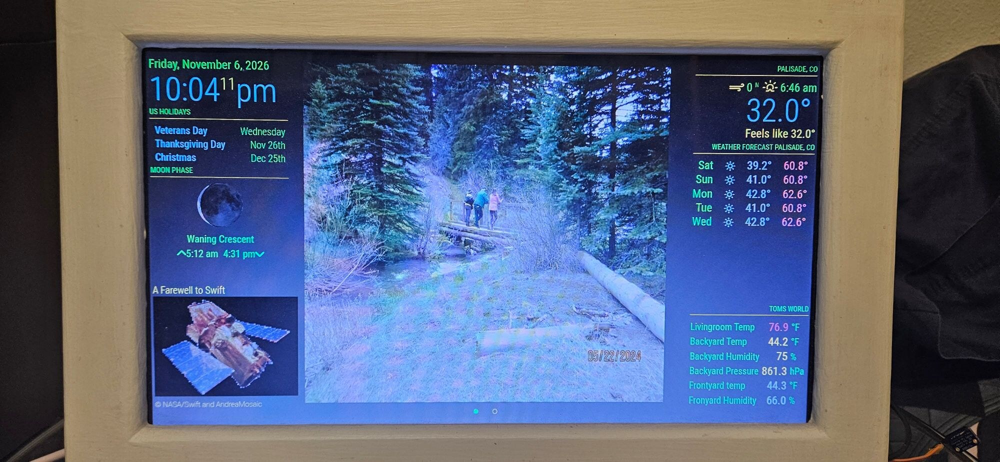
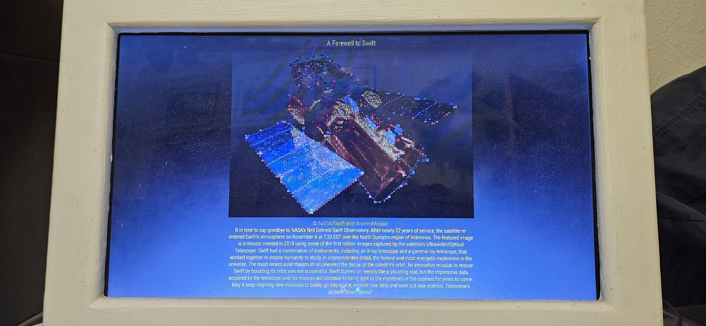

# MagicMirror² on an Orange Pi 3 LTS (DietPi, eMMC, Chromium kiosk)

A step-by-step guide to run [MagicMirror²](https://github.com/MagicMirrorOrg/MagicMirror) on an **Orange Pi 3 LTS** booting from its **onboard eMMC** (no SD card needed), with an **MCP9808 temperature sensor** publishing to MQTT.

The design is deliberately light:

- **DietPi** (minimal Debian) instead of a full desktop environment.
- **MagicMirror runs in server-only mode** as a systemd service.
- **Chromium in kiosk mode** (DietPi's minimal X, no Xfce, no Electron) shows `http://localhost:8080` full screen at boot.
- The **MQTT sensor script** runs as its own systemd service.

| Page 1 | Page 2 |
|---|---|
|  |  |

> **Status of this document:** tested on an Orange Pi 3 LTS running DietPi v10.8.2.

## Hardware

| Part | Notes |
|---|---|
| Orange Pi 3 LTS | Allwinner H6, 2 GB LPDDR3, 8 GB eMMC |
| Display | HDMI |
| MCP9808 breakout | I²C temperature sensor (default address `0x18`) |
| Power supply | 5 V, 3 A recommended |
| microSD card | Only needed once, to flash the eMMC (step 1) |
| Network | Ethernet or Wi-Fi, plus an MQTT broker on your LAN |

## 1. Flash DietPi to the eMMC

1. Download the DietPi image for the Orange Pi 3 LTS from <https://dietpi.com/#download> and write it to a microSD card (balenaEtcher or similar).
2. Boot the board from the SD card and let DietPi's first-run setup finish. SSH in as `dietpi`.
3. Identify the eMMC. The SD card is usually `mmcblk0` and the eMMC `mmcblk2`. **Go by the sizes, not the names**:

   ```bash
   lsblk -o NAME,SIZE,TYPE,MOUNTPOINT
   ```

   Example output (SD card `mmcblk0` is 29.7 GB, eMMC `mmcblk2` is 7.3 GB):

   ```
   NAME          SIZE TYPE MOUNTPOINT
   mmcblk0      29.7G disk
   └─mmcblk0p1  29.7G part /
   mmcblk2       7.3G disk
   └─mmcblk2p1   7.2G part
   mmcblk2boot0    4M disk
   mmcblk2boot1    4M disk
   ```

4. Write the image straight to the eMMC. This **erases everything on it**. First install the decompressor:

   ```bash
   sudo apt update && sudo apt install -y xz-utils
   ```

   Then stream the image from the DietPi download page (check the current filename for your board at <https://dietpi.com/#download>) onto the eMMC:

   ```bash
   wget -qO- https://dietpi.com/downloads/images/DietPi_OrangePi3LTS-ARMv8-Trixie.img.xz | xz -dc | sudo dd of=/dev/mmcblk2 bs=4M status=progress conv=fsync
   ```

5. Power off, **remove the SD card**, and power on. The board boots from the eMMC when no SD card is present. DietPi's first-boot setup runs again and expands the root filesystem to fill the eMMC.
6. Check:

   ```bash
   df -h /        # should show /dev/mmcblk2p1 at roughly 7 GB
   ```

## 2. Basic DietPi configuration

Run `sudo dietpi-config` and set:

- **Network options:** hostname, static IP or DHCP reservation (recommended, so the mirror is easy to reach).
- **Display options:** resolution and rotation if needed.
- **Language/Regional:** locale, timezone, keyboard.
- **Security options:** change the default passwords.

Update the system:

```bash
sudo apt update && sudo apt full-upgrade -y
```

### Reducing eMMC wear

DietPi keeps `/var/log` on a small tmpfs by default (`df -h` shows `/var/log` as `tmpfs`), which spares the flash. Check that `/tmp` is also tmpfs. Avoid installing services you do not need, and do not add swap on the eMMC.

## 3. Install the software

Install these from `dietpi-software` (run `sudo dietpi-software`, search, select, then *Install*), or from the command line using the IDs below (check the IDs on your version with `dietpi-software list`):

| Software | DietPi ID |
|---|---|
| Git | 17 |
| Node.js | 9 |
| Chromium (kiosk) | 113 |
| Python 3 pip | 130 |

```bash
sudo dietpi-software install 17 9 113 130
```

Installing Chromium pulls in a minimal X server. You do **not** need to install Xfce or any other desktop.

Then install the I²C and Python venv tools:

```bash
sudo apt install -y i2c-tools python3-venv
```

Check that Node meets MagicMirror's requirement (see the MagicMirror README for the current minimum):

```bash
node -v && npm -v
```

## 4. Install MagicMirror²

```bash
cd ~
git clone https://github.com/MagicMirrorOrg/MagicMirror
cd MagicMirror
npm run install-mm
cp config/config.js.sample config/config.js
```

### Install the extra modules

The example config in this repository (`config/config.js.example`) uses these third-party modules. Clone each into `~/MagicMirror/modules` and run `npm install` in it if it has a `package.json`:

| Module | Repository |
|---|---|
| MMM-ImageSlideshow | <https://github.com/mihanich/MMM-ImageSlideshow> |
| MMM-MoonPhase | <https://github.com/NolanKingdon/MMM-MoonPhase> |
| MMM-APOD | <https://github.com/grenagit/MMM-APOD> |
| MMM-MQTT | <https://github.com/ottopaulsen/MMM-MQTT> |
| MMM-pages | <https://github.com/edward-shen/MMM-pages> |
| MMM-page-indicator | <https://github.com/edward-shen/MMM-page-indicator> |
| MMM-Remote-Control | <https://github.com/Jopyth/MMM-Remote-Control> |

```bash
cd ~/MagicMirror/modules
git clone https://github.com/mihanich/MMM-ImageSlideshow
git clone https://github.com/NolanKingdon/MMM-MoonPhase
git clone https://github.com/grenagit/MMM-APOD
git clone https://github.com/ottopaulsen/MMM-MQTT
git clone https://github.com/edward-shen/MMM-pages
git clone https://github.com/edward-shen/MMM-page-indicator
git clone https://github.com/Jopyth/MMM-Remote-Control
for d in MMM-*/; do [ -f "$d/package.json" ] && (cd "$d" && npm install); done
```

**Patch `MMM-APOD` first.** NASA retired the `api.nasa.gov/planetary/apod` endpoint that `MMM-APOD` uses (it now returns an error), so the upstream module cannot load pictures. `patches/MMM-APOD-nasa-science-api.patch` in this repository switches it to NASA's `science.nasa.gov` endpoint, which needs no API key. It was written against upstream commit `3599a41`, so check that commit out and apply the patch (use the real path to your copy of this repository):

```bash
cd ~/MagicMirror/modules/MMM-APOD
git checkout 3599a41
git apply /path/to/this/repo/patches/MMM-APOD-nasa-science-api.patch
```

Do this before making the `MMM-APOD2` copy below, so the copy carries the fix.

**A second APOD module (`MMM-APOD2`).** MagicMirror cannot run two modules with the same name, so the second APOD instance is a renamed copy of the first. Copy the folder, rename the files, then rename every `MMM-APOD` inside them:

```bash
cd ~/MagicMirror/modules
cp -r MMM-APOD MMM-APOD2
cd MMM-APOD2
rm -rf .git
mv MMM-APOD.js MMM-APOD2.js
mv MMM-APOD.css MMM-APOD2.css
sed -i 's/MMM-APOD/MMM-APOD2/g' MMM-APOD2.js MMM-APOD2.css
grep -rn 'MMM-APOD' . | grep -v 'MMM-APOD2'    # should print nothing
```

Both modules request the same NASA endpoint at startup. If they start together, one can be refused and stay on "Loading..." forever, because the module does not retry after a 403 or 429. Prevent this by giving `MMM-APOD` a start delay in `config.js` (the example config already has it):

```js
initialLoadDelay: 10000,
```

### Configure MagicMirror

Edit `config/config.js`. A complete working example is in `config/config.js.example`: copy it over `config/config.js` and change the `CHANGE:` placeholders (latitude, longitude, UTC offset). The settings that matter for a mirror that is only viewed on the Pi itself:

```js
let config = {
	address: "localhost",   // only the local browser can connect
	port: 8080,
	basePath: "/",
	ipWhitelist: ["127.0.0.1", "::ffff:127.0.0.1", "::1"],
	language: "en",
	timeFormat: 24,
	units: "metric",
	modules: [
		// ... your modules
	]
};
if (typeof module !== "undefined") { module.exports = config; }
```

Set `address: "0.0.0.0"` and widen `ipWhitelist` only if you want to open the mirror from another device on your LAN.

> **Security:** the example config also loads `MMM-Remote-Control`, which can control the mirror over HTTP. It is safe while MagicMirror listens on `localhost` only. If you open the mirror to your LAN as described above, anyone on that network can use it unless you set an `apiKey` for the module (see its README), or remove the module.

Test it in the foreground:

```bash
npm run server
# in another SSH session:
curl -s http://localhost:8080 | head
```

Stop it with `Ctrl+C` once it works.

### Run MagicMirror as a service

Create `/etc/systemd/system/magicmirror.service` (confirm the npm path with `which npm`; on DietPi it is `/usr/local/bin/npm`):

```ini
[Unit]
Description=MagicMirror² server
After=network-online.target
Wants=network-online.target

[Service]
Type=simple
User=dietpi
WorkingDirectory=/home/dietpi/MagicMirror
ExecStart=/usr/local/bin/npm run server
Environment=NODE_ENV=production
Restart=always
RestartSec=10

[Install]
WantedBy=multi-user.target
```

```bash
sudo systemctl daemon-reload
sudo systemctl enable --now magicmirror.service
systemctl status magicmirror.service
```

## 5. Chromium kiosk on boot

1. Select the kiosk autostart and make sure the auto-login user is `dietpi`:

   ```bash
   sudo dietpi-autostart      # choose "Chromium" (kiosk)
   ```

2. Set the page it opens and the window size. First find the resolution X is really using (X runs as `dietpi`, so run `xrandr` as that user; the line marked `*` is the active mode):

   ```bash
   sudo -u dietpi env DISPLAY=:0 XAUTHORITY=/home/dietpi/.Xauthority xrandr
   ```

   Then in `/boot/dietpi.txt`, set the URL and make `RES_X`/`RES_Y` match that mode exactly (shown here for a 1366x768 panel):

   ```ini
   SOFTWARE_CHROMIUM_AUTOSTART_URL=http://localhost:8080
   SOFTWARE_CHROMIUM_RES_X=1366
   SOFTWARE_CHROMIUM_RES_Y=768
   ```

   If these are smaller than the screen, the mirror fills only part of it, with the bare X background showing on the right and bottom. `dietpi-config` display settings do not change this window size.

3. Chromium can start before the MagicMirror server is ready and show an error page. Make the autostart script wait for the server. Edit `/var/lib/dietpi/dietpi-software/installed/chromium-autostart.sh` and add this **before** the line that launches Chromium:

   ```bash
   until curl -sf http://localhost:8080 >/dev/null; do sleep 2; done
   ```

4. Reboot. The mirror should appear full screen with no desktop.

   ```bash
   sudo reboot
   ```

If the picture is rotated wrongly (portrait mirror), set the rotation in `dietpi-config` → *Display options*, or with `xrandr` in the autostart script.

## 6. Sensors → MQTT

Two sources publish to a Mosquitto broker running on the Pi, and MagicMirror's `MMM-MQTT` module shows the values:

- an **MCP9808** on the I²C header (sections 6.1 to 6.3)
- **ESP-NOW wireless sensors**, received by an ESP32 plugged into the Pi by USB (section 6.4)

### 6.0 Install the MQTT broker

```bash
sudo apt update && sudo apt install -y mosquitto mosquitto-clients
systemctl status mosquitto
```

By default Mosquitto 2.x accepts connections from the Pi itself only, with no login. That is enough here, because everything that publishes or subscribes runs on the Pi. Add a password file and a LAN listener only if you want other devices to publish directly.

Watch all sensor topics while you test the later steps:

```bash
mosquitto_sub -h localhost -t 'sensors/#' -v
```

### 6.1 Enable and check I²C

1. On this board `dietpi-config` has no I²C option, so enable it with a device-tree overlay in `/boot/dietpiEnv.txt`. The overlay files are in `/boot/dtb/allwinner/overlay`. Check that the `overlay_prefix` matches their filename prefix. The Orange Pi 3 LTS uses an Allwinner H6, so the prefix is `sun50i-h6`, not `meson` (which is for Amlogic boards):

   ```bash
   ls /boot/dtb/allwinner/overlay | grep -i i2c
   ```

   ```ini
   overlay_path=allwinner
   overlay_prefix=sun50i-h6
   overlays=i2c0
   ```

   Reboot, then check which `/dev/i2c-*` devices exist:

   ```bash
   ls /dev/i2c-*
   ```

2. Wire the MCP9808 (3.3 V, GND) and connect **SDA to header pin 3 and SCL to header pin 5**. With the `i2c0` overlay this appears as bus 0. The sensor is at address `0x18`:

   ```bash
   sudo i2cdetect -y 0
   ```

   A table with `18` in it means the sensor is found. All `--` means wrong bus, wiring, or overlay.

   As a normal user (after step 3), `i2cdetect` is not on your `PATH` because it lives in `/usr/sbin`. Run it as `/usr/sbin/i2cdetect -y 0`.

3. Let your user access I²C without root, then log out and back in:

   ```bash
   sudo usermod -aG i2c dietpi
   ```

### 6.2 Install the script

Keep the script outside the MagicMirror folder so MagicMirror updates never touch it:

```bash
mkdir -p ~/mcp9808 && cd ~/mcp9808
python3 -m venv venv
./venv/bin/pip install -r requirements.txt     # see the repo's requirements.txt
```

Put `mcp9808_mqtt.py` in `~/mcp9808/`. Keep MQTT host, user and password in a separate file that is **not** committed (for example `~/mcp9808/mqtt.env`), and commit an `mqtt.env.example` instead.

Test by hand:

```bash
./venv/bin/python3 mcp9808_mqtt.py
```

### 6.3 Run it as a service

Create `/etc/systemd/system/mcp9808-mqtt.service`:

```ini
[Unit]
Description=MCP9808 temperature to MQTT
After=network-online.target
Wants=network-online.target

[Service]
Type=simple
User=dietpi
WorkingDirectory=/home/dietpi/mcp9808
EnvironmentFile=/home/dietpi/mcp9808/mqtt.env
ExecStart=/home/dietpi/mcp9808/venv/bin/python3 -u /home/dietpi/mcp9808/mcp9808_mqtt.py
Restart=always
RestartSec=10

[Install]
WantedBy=multi-user.target
```

```bash
sudo systemctl daemon-reload
sudo systemctl enable --now mcp9808-mqtt.service
journalctl -u mcp9808-mqtt.service -f
```

(`EnvironmentFile` only works if the script reads its settings from environment variables. Remove that line if it does not.)

### 6.4 ESP-NOW gateway (USB serial → MQTT)

The ESP-NOW receiver ESP32 prints one JSON line per reading on its USB serial port (for example `{"id":"bme280","temp_f":72.1,"humidity":41.2,"pressure":1013.2}`). `serial_to_mqtt.py` reads those lines and publishes them as `sensors/<id>/temperature`, `sensors/<id>/humidity` and `sensors/<id>/pressure`.

1. Give your user access to the serial port, then log out and back in:

   ```bash
   sudo usermod -aG dialout dietpi
   ```

2. Plug in the receiver and find its port (it was `/dev/ttyACM0` here):

   ```bash
   ls /dev/ttyUSB* /dev/ttyACM* 2>/dev/null
   ```

   *Optional but recommended:* the port number can change after a reboot or when you plug in another USB device. Pin it with a udev symlink. An ESP32-C3's built-in USB shows as `303a:1001`, and every C3 has those same IDs, so match on the board's serial number too:

   ```bash
   udevadm info -a -n /dev/ttyACM0 | grep -E 'idVendor|idProduct|ATTRS\{serial\}' | head -3
   ```

   ```bash
   echo 'SUBSYSTEM=="tty", ATTRS{idVendor}=="303a", ATTRS{idProduct}=="1001", ATTRS{serial}=="<SERIAL>", SYMLINK+="esp_gateway"' | sudo tee /etc/udev/rules.d/99-esp-gateway.rules
   sudo udevadm control --reload-rules && sudo udevadm trigger
   ls -l /dev/esp_gateway
   ```

   Then use `SERIAL_PORT=/dev/esp_gateway` in step 3.

3. Install the script in its own folder, outside MagicMirror:

   ```bash
   mkdir -p ~/serial_to_mqtt && cd ~/serial_to_mqtt
   python3 -m venv venv
   ./venv/bin/pip install -r requirements.txt
   cp mqtt.env.example mqtt.env      # set SERIAL_PORT and the MQTT settings
   ```

4. Test by hand, with `mosquitto_sub` from section 6.0 running in another session:

   ```bash
   set -a; . ./mqtt.env; set +a; ./venv/bin/python3 serial_to_mqtt.py
   ```

5. Install `systemd/serial-to-mqtt.service` from this repository as `/etc/systemd/system/serial-to-mqtt.service`, then:

   ```bash
   sudo systemctl daemon-reload
   sudo systemctl enable --now serial-to-mqtt.service
   journalctl -u serial-to-mqtt.service -f
   ```

The script publishes with `retain=True`, so after a restart the mirror shows the last known values straight away rather than waiting for the next wireless reading.

## 7. Page button (GPIO)

A push button wired to the Pi turns the mirror to its next page. `pagebutton.py` watches the pin and sends `PAGE_INCREMENT` to `MMM-pages` through the `MMM-Remote-Control` HTTP API (`http://localhost:8080/api/notification/PAGE_INCREMENT`), so both modules must be installed (section 4).

### 7.1 Wiring

Connect a push button between **PD21** (wPi 13, GPIO 117), which is **header pin 22**, and **GND** on **header pin 20**. The two pins are on the same side of the 40-pin header, so one two-wire lead is enough. The script turns on the pin's internal pull-up, so it reads HIGH when idle and LOW when pressed, and no resistor is needed. The H6's PD bank has no interrupt support, so the script polls the pin (100 Hz, with a 30 ms debounce and a 0.5 s lockout between presses).

On this board PD21 is line 117 on `/dev/gpiochip1` (bank D is number 3, so 3 × 32 + 21 = 117). If your chip numbers differ, find the right one with:

```bash
sudo apt install -y gpiod
gpiodetect
gpioinfo | grep -n PD21
```

and edit `CHIP` and `LINE` at the top of the script.

### 7.2 Install the script

```bash
mkdir -p ~/pagebutton && cd ~/pagebutton
python3 -m venv venv
./venv/bin/pip install -r requirements.txt
```

Put `pagebutton.py` in `~/pagebutton/`, then test it by hand (press the button, and the mirror should change page):

```bash
sudo ./venv/bin/python pagebutton.py
```

### 7.3 Run it as a service

Install `systemd/pagebutton.service` as `/etc/systemd/system/pagebutton.service`, then:

```bash
sudo systemctl daemon-reload
sudo systemctl enable --now pagebutton.service
journalctl -u pagebutton.service -f
```

The unit has no `User=`, so it runs as root, which can open `/dev/gpiochip*` without any permission changes. Do **not** rely on `chown`/`chmod` of `/dev/gpiochip*` to run it as a normal user: those changes are lost at every reboot, because the device nodes are recreated. To run it as `dietpi`, add a udev rule and put `User=dietpi` in the unit:

```bash
echo 'SUBSYSTEM=="gpio", KERNEL=="gpiochip*", GROUP="dialout", MODE="0660"' | sudo tee /etc/udev/rules.d/99-gpio.rules
sudo udevadm control --reload-rules && sudo udevadm trigger
```

If you set an `apiKey` for `MMM-Remote-Control` (section 4), the URL in `pagebutton.py` needs `?apiKey=<key>` on the end, or the presses are rejected.

## 8. Backup and restore

- DietPi's built-in tool: `sudo dietpi-backup` backs up system configuration.
- Back up what DietPi does not know about: `~/MagicMirror/config/config.js`, any custom modules in `~/MagicMirror/modules/`, `~/mcp9808/`, and the two service files.

  ```bash
  tar czf ~/mm-backup.tgz ~/MagicMirror/config ~/MagicMirror/modules ~/mcp9808 \
      /etc/systemd/system/magicmirror.service /etc/systemd/system/mcp9808-mqtt.service
  ```

- Copy the archive off the Pi (`scp`) so it survives an eMMC failure.

## 9. Troubleshooting

| Symptom | Check |
|---|---|
| Black screen after boot | `systemctl status magicmirror`; confirm `dietpi-autostart` is set to Chromium kiosk; check the resolution in `dietpi.txt` |
| "This site can't be reached" in the browser | The server was not ready; add the `curl` wait loop (step 5.3) |
| `Permission denied` on `/dev/i2c-*` | User is not in the `i2c` group, or you have not logged out and in again |
| `i2cdetect` shows nothing | Wrong bus, wiring, or the I²C overlay is not enabled |
| Service keeps restarting | `journalctl -u <service-name> -n 50`; for the sensor script, confirm the broker is reachable |
| Mirror slow or laggy | The H6 GPU has no good Chromium acceleration; keep modules and animations light |

## Files in this repository

```
README.md                  this guide
config/config.js.example   MagicMirror config with secrets removed
systemd/*.service          the service files (magicmirror, mcp9808-mqtt, serial-to-mqtt, pagebutton)
mcp9808/mcp9808_mqtt.py    sensor script
mcp9808/requirements.txt   Python dependencies
mcp9808/mqtt.env.example   MQTT settings template (never commit the real mqtt.env)
LICENSE                    MIT licence
docs/                      screenshots of the finished mirror
serial_to_mqtt/            ESP-NOW gateway: serial_to_mqtt.py, requirements.txt, mqtt.env.example
pagebutton/                page-turn button on a GPIO pin: pagebutton.py, requirements.txt
```

## License

MIT, see [LICENSE](LICENSE). The patch in `patches/` modifies [MMM-APOD](https://github.com/grenagit/MMM-APOD); check that module's own repository for its licence.
